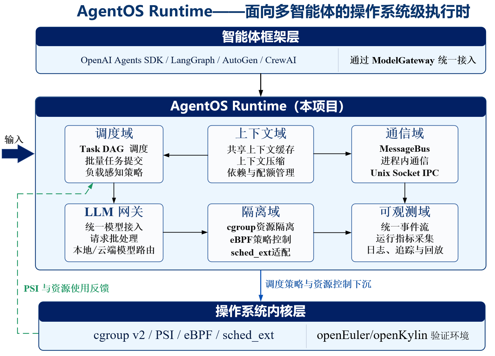

# AgentOS Runtime — 面向多智能体的操作系统级执行时

> 第三届中国研究生操作系统开源创新大赛决赛作品 · MillionTokens

AgentOS Runtime 位于多智能体框架与操作系统之间，为 Agent 提供统一的执行身份、动态任务调度、共享上下文、故障恢复、资源控制和事件记录。上层框架继续负责业务编排，运行时将协作流程落实为可管理、可追踪的执行过程。

源代码位于 `src/`，文档位于 `docs/`，测试及实验记录位于 `tests/`，可验证交付物位于 `demo/`，赛后新增的对照实验位于 `experiments/`。

## 核心特性

- **统一执行实体**：通过 Agent 控制块（ACB）关联任务、状态、上下文引用、资源配额和 `trace_id`。协程 Handler 共享宿主进程；子进程 Worker 关联独立 PID 与 cgroup，明确两种执行路径的资源边界。
- **动态依赖调度**：TaskDAG 支持并行分支与运行中追加任务。调度器先筛选依赖就绪任务，再检查资源预算与压力反馈，依据延迟、吞吐、缓存亲和、公平性或风险策略排序派发。
- **引用共享与按需输入**：共享原文进入上下文池，Agent 间通过 ContextRef 交接成果。调用模型前按任务展开所需内容、控制预算并组织稳定前缀，将通信载荷、模型输入 Token 和模型侧 KV 缓存分别管理与统计。
- **局部故障恢复**：统一处理 Handler、Worker 与工具执行异常，按 RecoveryPolicy 选择重试、回退、上下文重试、跳过或终止；受影响后继等待恢复结果，独立分支继续推进。
- **OS 资源控制与内核调度**：将 Worker 的资源和调度决策关联到 cgroup v2、PSI、BPF policy map 与 sched_ext。已归档的真实内核验证采用 `6.12.95-agentos-scx`，partial mode 仅接管显式绑定的 Agent Worker。
- **统一可观测性**：Agent、Task、模型、上下文、工具、资源、调度与故障事件写入 JSONL EventLog，供 CLI、Dashboard 和工作台查询、回放与分析。
- **多框架与多后端接入**：提供 LangGraph、AutoGen、CrewAI、OpenAI Agents SDK 的对比接入脚本，以及 DeepSeek、vLLM、LiteLLM 和离线 mock 后端；框架原有编排与 Runtime 执行管理可以组合使用。

## 1. 项目背景

多智能体应用通常由用户态框架组织任务流程。随着 Agent 数量和协作步骤增加，资源竞争、重复上下文、故障传播和执行记录需要跨框架、跨执行路径统一处理。

| 问题 | 典型表现 | AgentOS Runtime 的处理方式 |
| --- | --- | --- |
| 执行身份与状态分散 | 任务、模型调用、工具和进程之间缺少统一关联 | ACB 关联任务、生命周期、资源与追踪标识 |
| 协作与资源调度脱节 | 依赖已经满足，但资源预算或系统压力不允许立即执行 | TaskDAG 就绪筛选、资源准入与策略排序 |
| 上下文重复传递 | 多个 Agent 重复接收背景材料和中间结果 | 共享上下文池、ContextRef、按需装配与稳定前缀 |
| 故障影响扩大 | 单个任务失败后，整个工作流重复执行或失去进度 | 依赖影响边界、局部恢复与独立分支保留 |
| 执行过程难以核验 | 展示结果无法关联到调用、事件和资源状态 | EventLog、统一 `trace_id` 与可查阅的实验产物 |

项目适用于软件工程协作、仓库审阅、运维诊断、研究与知识处理等任务，并在决赛材料中以软件维护、旅行规划、航空与零售客服三个场景展示上下文复用效果。

## 2. 系统架构



系统采用三层架构：

| 层次 | 职责 | 主要组件 |
| --- | --- | --- |
| 应用与框架层 | 描述业务目标、分工与框架内部编排 | LangGraph、AutoGen、CrewAI、OpenAI Agents SDK、CLI 与工作台 |
| Runtime 层 | 管理执行实体、任务依赖、上下文、模型请求、通信与恢复 | ACB、TaskDAG、Scheduler、ContextRef、Model Gateway、RecoveryPolicy、EventLog |
| 操作系统层 | 承载独立 Worker，执行资源控制与内核调度 | Linux 进程、cgroup v2、PSI、BPF、sched_ext |

典型执行链路为：

```text
提交任务或框架计划
  → 建立 ACB 与 TaskDAG
  → 依赖筛选、资源检查、策略排序
  → 派发 Handler 或 Worker
  → 按 ContextRef 装配模型输入、执行工具
  → 发布结果引用、更新任务状态
  → 释放满足条件的后继任务
  → EventLog 记录全过程
```

调度与 OS 反馈形成双向链路：Runtime 输出 Worker 配额和调度策略，适配层执行资源控制与内核策略绑定；用量、PSI 和执行状态再回写 Runtime，影响后续准入和派发。协程 Handler 共享宿主进程资源，不能将它的逻辑 Agent 身份等同于独立 PID 或独立 cgroup。

## 3. 核心模块详解

### 3.1 执行抽象：ACB 与生命周期

代码入口：`src/agentos/core/`、`src/agentos/runtime/`。

ACB 记录 `agent_id`、角色、任务、状态、模型后端、上下文引用、资源配额、资源用量与 `trace_id`。独立进程执行时还可关联 `pid` 和 `cgroup`。

- 以受约束的状态转换表达创建、就绪、运行、等待模型或工具、挂起、恢复、完成与失败。
- 将任务执行、模型调用、工具使用与故障事件关联到同一执行身份。
- 支持协程 Handler 与子进程 Worker 两条执行路径，由统一运行时管理状态与结果。

### 3.2 调度域：动态 TaskDAG 与资源感知

代码入口：`src/agentos/scheduler/`、`src/agentos/core/task.py`。

- 表达任务依赖、并行分支和运行中追加的任务，拒绝非法依赖与环路。
- 前置任务完成后，将后继纳入就绪集合；资源准入通过后再派发。
- 结合任务属性、前缀热度、等待风险、SLA 与 OS 压力选择调度策略。
- 记录策略选择、公平性与饥饿风险，使决策可以从事件中追踪。

| 策略 | 名称 | 主要考虑因素 |
| --- | --- | --- |
| `LATENCY_FIRST` | 延迟优先 | 交互任务、优先级与响应需求 |
| `THROUGHPUT_FIRST` | 吞吐优先 | 批量任务与可用并行度 |
| `CACHE_AFFINITY` | 缓存亲和 | 共同前缀与缓存复用机会 |
| `FAIRNESS_BALANCED` | 公平均衡 | 等待时间、饥饿风险与压力告警 |
| `RISK_AWARE` | 风险感知 | 关键 SLA、紧迫性、任务风险与高压力 |

上述策略属于 Runtime 决策；只有满足内核通路条件并显式绑定的 Worker，才由 sched_ext 执行相应的内核调度。

### 3.3 上下文域：ContextRef、权限与预算

代码入口：`src/agentos/context/`。

- 通过 ContextRef 标识共享、私有、任务和工具结果上下文，记录所有者、权限、内容哈希与优先级。
- 将可共享原文登记到上下文池，协作消息交接引用，下游按任务选择需要的材料。
- 对未授权读取执行拒绝并产生审计事件，保持私有上下文隔离。
- 调用模型前按引用展开原文，支持稳定前缀、压缩、按预算淘汰和依赖相关的内容选择。

ContextRef 减少的是协作消息中的重复正文搬运；模型输入是否减少，取决于实际选取和装配的内容；KV 缓存是否命中，还取决于模型后端的缓存能力与状态。这三类开销分别统计，不能把引用消息直接等同于“模型零 Token”或模型内存零拷贝。

### 3.4 故障域：RecoveryPolicy 与局部恢复

代码入口：`src/agentos/fault/`、`src/agentos/runtime/engine.py`。

| 恢复动作 | 作用 |
| --- | --- |
| `RETRY` | 在尝试次数限制内重新执行 |
| `FALLBACK` | 使用配置的备用角色执行 |
| `CONTEXT_RETRY` | 恢复失败 Agent 的上下文快照后重试 |
| `SKIP` | 跳过失败任务，由依赖处理逻辑决定后继状态 |
| `FAIL` | 结束恢复尝试并记录失败 |

失败任务的依赖后继无法立即执行，独立分支保留进度并继续推进。恢复成功后重新检查依赖条件；最终失败时保留失败或跳过状态，并处理依赖它的任务。

上下文重试恢复失败 Agent 的私有快照，清理失败尝试之后写入的私有内容，同时保留其他分支对共享上下文的更新。该机制恢复上下文引用与内容，不自动撤销外部工具已经产生的文件、网络或业务副作用。

### 3.5 Worker、隔离与 OS 资源控制

代码入口：`src/agentos/worker/`、`src/agentos/isolation/`、`src/native/sched_ext/`。

- 管理子进程 Worker 的启动、PID 关联、退出与资源清理。
- 通过 cgroup v2 设置和读取资源配额，采集用量与 PSI 压力。
- 通过 BPF policy map 传递 Worker 调度属性，并核验进程与策略的关联。
- sched_ext 调度器包含 LATENCY、NORMAL、BATCH 三类 DSQ，在 partial mode 下管理显式绑定的 Worker。
- 条件不满足或通路异常时按配置拒绝严格路径或回退，并记录实际运行状态。

### 3.6 通信域：MessageBus 与引用交接

代码入口：`src/agentos/comm/`。

统一消息总线支持进程内通信和 Unix 域套接字 IPC，提供 JSON 消息编解码、消息记录与载荷统计。上下游可通过结果引用通知完成状态，并按权限取用共享成果。

### 3.7 模型网关：多后端与请求批处理

代码入口：`src/agentos/llm/`。

- 统一模型请求、响应、Token 用量、延迟与缓存信息。
- 支持 DeepSeek 云端接口、本地 vLLM、LiteLLM 与离线 mock 后端。
- 提供按前缀分组和自适应批处理能力。
- 保留模型服务返回的 usage，并区分真实返回值、估算值、不可观测项与模拟数据。

`mock`、`cache-sim` 等模拟后端用于链路与功能验证，其缓存或时延数据不代表真实模型性能。

### 3.8 可观测域：EventLog、Dashboard 与工作台

代码入口：`src/agentos/events/`、`src/agentos/dashboard/`、`src/agentos/workbench/`。

EventLog 以 JSONL 保存执行状态、调度决策、模型请求、上下文、工具、资源和故障事件。同一 `trace_id` 用于关联故障触发、恢复动作与任务完成，CLI 和可视化界面据此查询与回放。

Dashboard 展示的数据范围由输入日志和实验批次决定。使用历史记录、模拟后端或真实模型时，应保留对应的来源标识，不将回放画面当作正在进行的实时实验。

### 3.9 框架接入与任务执行

代码入口：`src/agentos/adapters/`、`src/agentos/execution/`、`src/scripts/cloud_bench/`。

项目既提供将框架计划转换为 Runtime 任务图的接入方式，也提供保留框架原有编排、仅在模型调用层接入 Model Gateway 的对比实验方式。两类接入范围不同，模型调用层的对比结果不自动证明每个框架都使用了完整的 Worker、cgroup 与 sched_ext 执行链。

未编译的 LangGraph 静态 `StateGraph` 可通过 `adapt_state_graph` 自动生成逐节点 TaskDAG、结果引用和 handlers，每个节点由 Runtime 建立独立 ACB。接口、状态合并语义与支持边界见 [LangGraph 静态图接入](docs/langgraph_adapter.md)。

## 4. 快速开始

以下命令在仓库根目录执行，面向 Linux 或具备相应 Linux 条件的 WSL 环境。Python 要求为 **3.11 及以上**。

### 4.1 创建环境与安装

```bash
python3 -m venv .venv
.venv/bin/python -m pip install -e "./src[dev,app,langgraph]"
```

按需安装四框架实验依赖：

```bash
.venv/bin/python -m pip install -e "./src[cloud-bench]"
```

基础依赖为 `pydantic`、`litellm` 和 `httpx`；`dev` 提供测试依赖，`app` 提供工作台依赖，`langgraph` 提供 LangGraph 接入依赖。精确声明见 [`src/pyproject.toml`](src/pyproject.toml)，锁文件见 [`src/uv.lock`](src/uv.lock)。

如需严格复用锁定依赖，可使用：

```bash
UV_PROJECT_ENVIRONMENT="$PWD/.venv" uv sync \
  --project src --locked --extra dev --extra app --extra langgraph
```

### 4.2 验证安装与运行测试

```bash
.venv/bin/agentctl --help
.venv/bin/python -m pytest -c src/pyproject.toml tests -q
```

测试覆盖执行、调度、上下文、网关、通信、故障、隔离、事件与工作台。当前测试说明登记 **127 个回归测试文件、1674 项测试**；实际收集数、通过数与跳过数以当前环境的 pytest 输出为准，不能用历史批次的通过数代替当前运行结果。

### 4.3 离线功能演示

无需 API 凭据、GPU 或 sched_ext 内核：

```bash
bash demo/01-离线功能演示/run_offline_validation.sh
```

该演示验证依赖执行、上下文选择、单分支故障隔离、重试恢复与事件记录，默认写入 `demo/output/离线功能演示/`。脚本要求输出目录尚不存在；重复运行时可指定一个新目录：

```bash
bash demo/01-离线功能演示/run_offline_validation.sh \
  demo/output/offline_second_run
```

输出包含 `summary.json`、`report.md`、`events.jsonl`、`requests.jsonl` 和 `dashboard.html`。离线演示采用 mock 后端，验证功能链路，不用于测量真实模型质量或性能。

### 4.4 实时 Dashboard

```bash
.venv/bin/agentctl live --scenario software_eng --backend mock \
  --log demo/output/software_eng_mock/events.jsonl
```

浏览器访问 `http://127.0.0.1:9400`。软件工程场景展示任务图、调度、上下文与故障恢复；默认故障注入可通过 `--no-fault` 关闭，另支持 `devops`、`research` 等场景。

### 4.5 查看已归档的真实接口演示

无需重新调用模型即可打开归档的 [`dashboard.html`](demo/03-真实模型场景/结果/finals_deepseek_20260907/dashboard.html)，或从同一事件流生成新的静态面板：

```bash
.venv/bin/agentctl dashboard \
  --log demo/03-真实模型场景/结果/finals_deepseek_20260907/events.jsonl \
  --output demo/output/archived_dashboard.html
```

此归档来自 2026-09-07 的真实接口功能演示，不能替代决赛三场景性能汇总。更详细的输入、usage 与结果范围见 [`demo/03-真实模型场景/README.md`](demo/03-真实模型场景/README.md)。

### 4.6 真实模型与工作台

设置自己的模型凭据后运行：

```bash
export DEEPSEEK_API_KEY='填写自己的接口凭据'
.venv/bin/agentctl finals-demo --backend deepseek \
  --output demo/output/finals_deepseek_new
```

工作台与自然语言仓库任务使用任务目录中的 `.agentos.toml` 配置：

```bash
cp demo/examples/agentctl/deepseek-high.toml /path/to/task/.agentos.toml
.venv/bin/agentctl app --cwd /path/to/task
.venv/bin/agentctl exec --cwd /path/to/task "检查这个仓库并生成审阅报告"
```

样例配置启用了 bubblewrap 沙箱，需安装 bubblewrap 并允许用户命名空间。真实模型、vLLM 仓库审阅和执行配置详见 [`demo/03-真实模型场景/`](demo/03-真实模型场景/)。

## 5. 平台适配与内核验证

| 平台或运行层次 | 实现方式 | 可验证的内容 |
| --- | --- | --- |
| 通用 Linux 用户态 | Python 包、CLI、Dashboard、工作台 | 任务执行、上下文、通信、恢复与可观测性 |
| openEuler 24.03 LTS | `src/Dockerfile.openeuler` | 容器构建、安装、回归测试与独立资源控制检查 |
| openKylin | `src/Dockerfile.openkylin`；决赛归档环境为 2.0 SP2 | 容器构建、Python 环境与回归测试 |
| 指定 openEuler 内核环境 | `6.12.95-agentos-scx` 与原生组件 | Worker 接管、三类 DSQ、策略绑定、回退与可靠性 |

### 5.1 容器构建与测试

```bash
docker build -f src/Dockerfile.openeuler -t agentos-openeuler .
docker run --rm agentos-openeuler

docker build -f src/Dockerfile.openkylin -t agentos-openkylin .
docker run --rm agentos-openkylin
```

两个镜像的默认命令均为全量回归测试。openEuler 的构建、Python 检查、回归与独立 cgroup 验证可通过以下入口执行：

```bash
bash src/scripts/openeuler-verify.sh
```

当前 openKylin 构建文件使用 `openkylin/openkylin:latest`；归档结果对应当时镜像，复现时需记录实际镜像版本。容器与宿主共享内核，容器构建成功不等同于相应发行版原生内核上的 sched_ext 调度验证。

### 5.2 sched_ext 原生组件

原生组件构建依赖 gcc、clang、make、libelf、zlib，以及指定提交且已构建 `vmlinux` 的 Linux 源码树：

```bash
make -C src/native/sched_ext \
  KERNEL_SRC=/opt/kernel-src/linux-6.12.y all
```

- 内核分支：`linux-6.12.y`。
- 固定源码提交：`296aabce459470a4c1b68ffd0c0c0920e563aaad`。
- 归档验证版本：`6.12.95-agentos-scx`。
- 调度范围：partial mode，仅管理显式绑定为 `SCHED_EXT` 的 Agent Worker。

加载、运行、清理和分阶段验收需要对应实验环境与权限，完整步骤见 [`src/native/sched_ext/README.md`](src/native/sched_ext/README.md) 和 [`demo/04-内核通路/`](demo/04-内核通路/)。

### 5.3 分阶段验证与冻结归档

验证链覆盖 Runtime 策略出口、cgroup 配额、PSI 反馈、BPF map、真实 Worker 接管、策略对照、异常回退和长时运行。阶段 6 归档保留阶段 4 的五模式、每模式 20 轮正式性能样本；后续三轮回归样本单独记录。

冻结报告记录 **380/380 项可靠性试验通过、约 3603 秒长时运行、任务丢失数为 0**。完整报告、原始记录、环境和校验和见 [`tests/测试及验证材料/results/sched_ext_stage6/`](tests/测试及验证材料/results/sched_ext_stage6/)。这是指定环境下的实验结果，调度器不替换 Linux 全部调度类。

## 6. 实验与评测体系

### 6.1 决赛展示结果

下表采用当前决赛 PPT 与演示视频的展示口径；不同实验的指标分别解释，不将通信载荷、输入 Token、调度延迟和任务完成率合并为一个性能结论。

| 指标 | 展示结果 | 实验范围与含义 |
| --- | --- | --- |
| 引用通信载荷 | 412.7 kB → 5.2 kB，减少 **98.7%** | 独立通信微基准，衡量消息内容字节数，不代表时延或吞吐提升 |
| 三场景平均输入 Token | 减少 **60.2%** | 决赛 PPT 的软件维护、旅行规划、客服协作汇总口径 |
| 旅行规划通过率 | **96.7% → 96.7%** | 对应旅行场景及其判定规则 |
| 客服动作正确率 | **70.0% → 73.3%** | 航空与零售客服的动作选择，不等同于官方完整业务成功率 |
| 框架级故障恢复 | **2/6 → 6/6** | 决赛材料中的框架级恢复验证，与任务完成数分开统计 |
| 故障工作负载任务完成 | **14/28 → 28/28** | 四类工作负载共 28 个任务，每组注入一个故障；28 为任务数 |
| 故障矩阵事件记录 | **399 条** | 同一批故障工作负载的 EventLog 记录 |
| Worker 调度延迟 P95 | 降低约 **67.7%** | 固定 CPU 混合微基准，完整策略对比 CFS，不是模型端到端时延 |
| Runtime 自身内存 | **41 MiB** | 8 个工作流、64 个 Agent 的展示配置，不含模型权重整体内存 |

输入 Token 的 60.2% 为决赛材料中的三场景汇总，不能用历史 SWE-bench 30 任务单一批次直接替代或重算。复核该指标时需使用相同场景范围和汇总规则；历史记录保留其原始模型标识、日期、usage 与统计口径。

调度侧的冻结正式样本中，latency 任务 P95 的各轮均值由约 `5686.908 μs` 降至 `1839.635 μs`，对应约 67.7% 的降幅；同一微基准吞吐约下降 0.8%。完整对照及其他模式见 [阶段 6 冻结报告](tests/测试及验证材料/results/sched_ext_stage6/report.md)。

### 6.2 三类协作场景与四框架对比

| 场景 | 决赛展示的任务来源 | Agent 数量 |
| --- | --- | ---: |
| 软件维护 | SWE-bench Verified | 6 |
| 旅行规划 | TravelPlanner-lite | 7 |
| 航空与零售客服 | TAU-bench 场景改造 | 4 |

框架对比涉及 LangGraph、AutoGen、OpenAI Agents SDK 与 CrewAI，材料覆盖云端 API 与本地 vLLM。模型标识和硬件配置以具体批次材料为准。

四框架对比脚本位于 `src/scripts/cloud_bench/`，旅行与客服评测入口分别为 `src/scripts/travelplanner_lite_harness_real.py` 和 `src/scripts/tau_bench_harness_real.py`。SWE-bench 工作流 Token 指标不等同于官方补丁通过率；TAU 场景动作正确率也不等同于官方 `pass^k` 成绩。

### 6.3 仓库内的实验归档

以下目录均相对于 [`tests/测试及验证材料/`](tests/测试及验证材料/)：

| 归档目录 | 内容 |
| --- | --- |
| `results/swe_bench_verified_30/` | 2026-07-09 的 30 任务、四框架批次，含任务清单、逐任务结果与运行元数据 |
| `results/framework_benchmark_4fw_real/` | 四框架 10 任务试运行，独立于正式 30 任务批次 |
| `results/workload_matrix_deepseek_real/` | AI 推理、编译、压缩、网络四类负载的 baseline/runtime 对照及事件流 |
| `results/ppt_data/` | 历史消融、通信与故障传播结果，不自动等同于最新决赛汇总 |
| `results/feedback_loop_bundle/` | 资源反馈回路、时间线与消融结果 |
| `results/kernel_probe/` | cgroup v2、PSI 和 pinned BPF map 的验证 |
| `results/sched_ext_stage6/` | 内核接管、五模式对照、回退、可靠性与冻结归档 |
| `results/platform_openkylin/` | openKylin 镜像、构建和测试日志 |
| `results/defense/` | 模拟后端的事件面板与负载矩阵，用于功能和展示验证 |

真实接口功能演示另见 `demo/03-真实模型场景/结果/finals_deepseek_20260907/`。实验复现入口、结果引用规则和归档范围见 [`tests/测试及验证材料/README.md`](tests/测试及验证材料/README.md)。

## 7. 项目结构

```text
项目根目录/
├── README.md
├── src/
│   ├── agentos/                         Runtime Python 源代码
│   │   ├── core/                       ACB、任务、状态与资源抽象
│   │   ├── runtime/                    执行引擎、依赖释放与恢复集成
│   │   ├── scheduler/                  动态 DAG、五类策略与压力反馈
│   │   ├── context/                    ContextRef、权限、预算与前缀
│   │   ├── comm/                       消息总线与 Unix Socket IPC
│   │   ├── llm/                        模型网关、后端与批处理
│   │   ├── worker/                     子进程生命周期与执行沙箱
│   │   ├── isolation/                  cgroup、PSI、BPF 与内核适配
│   │   ├── fault/                      故障注入、超时与恢复策略
│   │   ├── events/                     统一 EventLog
│   │   ├── dashboard/                  静态、实时与回放面板
│   │   ├── workbench/                  本地任务工作台
│   │   ├── adapters/ · execution/      框架计划接入与任务执行
│   │   ├── scenarios/ · benchmarks/   应用场景与实验统计
│   │   └── tools/ · metrics/           工具管理与指标聚合
│   ├── native/sched_ext/               BPF 调度器、加载器与基准 Worker
│   ├── scripts/                        实验、验证与演示入口
│   ├── Dockerfile.openeuler
│   ├── Dockerfile.openkylin
│   ├── pyproject.toml
│   └── uv.lock
├── docs/
│   ├── langgraph_adapter.md            LangGraph 静态图接入说明
│   ├── semantic_recovery.md            语义失败恢复说明
│   └── images/architecture.png
├── experiments/                        赛后对照实验（按需装配、缓存亲和、语义恢复）
├── tests/
│   ├── test_*.py                       自动化回归测试
│   └── 测试及验证材料/                  固定输入、原始记录与实验归档
├── demo/
│   ├── 01-离线功能演示/
│   ├── 02-国产系统部署/
│   ├── 03-真实模型场景/
│   ├── 04-内核通路/
│   ├── examples/                       示例与任务配置
│   └── replay/                         历史回放配置
└── LICENSE
```

本地运行产物写入被 Git 忽略的 `demo/output/` 或 `tests/测试及验证材料/results/generated/`，不覆盖固定实验归档。

## 8. 工程规模与验证状态

以下文件规模按 2026-10-03 的决赛仓库已跟踪文件统计：

| 维度 | 当前规模或记录 |
| --- | --- |
| Runtime Python 源码 | `src/agentos/` 下 143 个 `.py` 文件，27,468 行文本 |
| 实验、验证与辅助脚本 | `src/scripts/` 下 107 个 Python/Shell 文件，包含包初始化与辅助模块 |
| 回归测试文件 | `tests/` 根层级 127 个 `test_*.py` 文件 |
| 测试项规模 | 当前测试说明登记 1674 项，以实际 pytest 收集和执行结果为准 |
| 内核侧组件 | BPF 调度器、用户态加载器、Worker 与 CPU 微基准组件 |
| 历史测试归档 | openEuler 与 Debian 的归档记录退出码为 0；openKylin 2026-07-11 批次为 1331 项通过 |
| 决赛展示材料 | 23 页图片定稿 PPT；约 4 分 12 秒、1080p、含字幕与配音的 MP4 |

源码文本行包含注释和空行，不包含原生 C 组件、测试和实验脚本。文件数、测试项数、历史通过数采用不同统计范围；本表不表示在每个支持环境中都重新执行了当前全部测试。

测试入口见 [`tests/README.md`](tests/README.md)，历史环境记录见 [`demo/02-国产系统部署/README.md`](demo/02-国产系统部署/README.md) 与 [`pytest_results.json`](tests/测试及验证材料/results/sched_ext_stage6/pytest_results.json)。

## 9. 文档导览

| 文档或材料 | 内容 |
| --- | --- |
| [可验证交付物](demo/README.md) | 四层演示与部署入口 |
| [赛后实验报告](experiments/REPORT_20261019.md) | 按需装配、缓存亲和与语义恢复的本地模型实验 |
| [回归测试说明](tests/README.md) | 测试安装、运行与覆盖范围 |
| [实验材料索引](tests/测试及验证材料/README.md) | 归档记录、复现入口与引用规则 |
| [sched_ext 原生组件说明](src/native/sched_ext/README.md) | 固定内核、构建、加载与验收流程 |

## 10. 团队分工

决赛阶段分工：

- **成员 A（组长）**：项目统筹、执行编排集成、故障处理与可观测性；组织 CLI、Dashboard、实验材料、平台验证与决赛展示。
- **成员 B**：ContextRef、共享与私有上下文、权限、压缩与预算管理；Model Gateway、多后端、前缀与缓存指标。
- **成员 C**：Runtime 内核、Agent 生命周期、TaskDAG、资源感知调度、Worker 执行链，以及 cgroup v2、PSI、BPF/sched_ext 适配与验证。

## 11. 开源许可

本项目主体以 **Apache License 2.0** 开源。`src/native/sched_ext/` 中改编自 Linux sched_ext 示例的 BPF 调度器与加载器适用 **GPL-2.0**；原生组件来源、固定上游提交与构建要求见该目录说明，具体文件保留其许可声明。

## 12. 致谢

- **openEuler / openKylin 社区**：国产操作系统用户空间、构建与验证环境。
- **Linux cgroup、PSI、eBPF 与 sched_ext**：资源控制、压力反馈与可扩展调度基础。
- **vLLM、DeepSeek 与 OpenAI-compatible 模型服务**：本地及云端模型后端。
- **LangGraph、AutoGen、CrewAI、OpenAI Agents SDK**：框架接入与对比实验。
- **pydantic、LiteLLM、httpx、aiohttp 与 pytest**：数据模型、模型调用、网络服务和工程测试。
